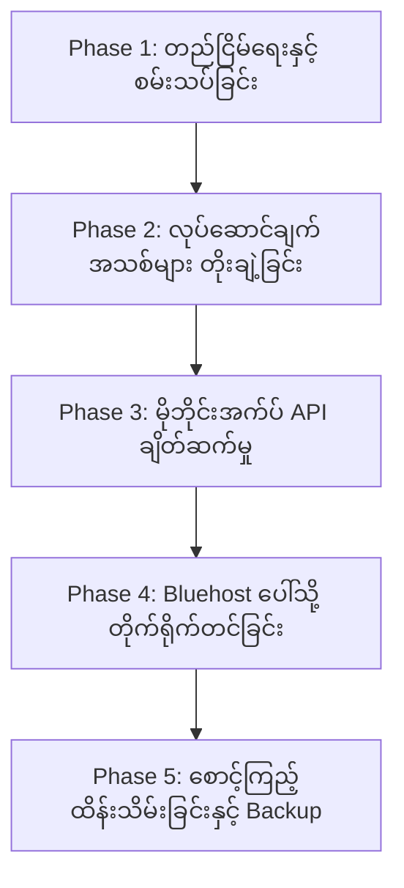

# 📋 ပုံ့ပုံ့ အိတ်ဆိုင် (Pont Pont Handbag Shop) - စီမံကိန်း ဖွံ့ဖြိုးတိုးတက်ရေး လုပ်ငန်းစဉ် (Project Plan)

ဤအစီအစဉ် (Plan) သည် **Pont Pont Handbag Shop** (Bluehost PHP/MySQL Backend, Web Storefront, Admin Panel နှင့် Flutter Mobile App API) စနစ်အား စနစ်တကျ ရေရှည်ဖွံ့ဖြိုးတိုးတက်စေရန်၊ လုံခြုံစိတ်ချရစေရန်နှင့် Bluehost Web Hosting ပေါ်တွင် အောင်မြင်စွာ တိုက်ရိုက်လွှင့်တင် (Deploy) နိုင်ရန် ရေးဆွဲထားသော မဟာဗျူဟာမြောက် စီမံကိန်း လုပ်ငန်းစဉ် ဖြစ်ပါသည်။

---

## 📌 ၁။ စီမံကိန်း အကျဉ်းချုပ် (Project Overview)

- **စီမံကိန်းအမည်:** Pont Pont Handbag Shop (ပုံ့ပုံ့ အိတ်မျိုးစုံ ရောင်းဝယ်ရေး - မန္တလေး)
- **အဓိက နည်းပညာများ (Tech Stack):**
  - **Backend:** PHP 8.x (Native PDO, Vanilla PHP, Object-Oriented/Modular Approach)
  - **Database:** MySQL 8.0 / MariaDB (utf8mb4 Unicode Support)
  - **Frontend:** HTML5, Tailwind CSS (CDN), Vanilla JavaScript, Lucide Icons
  - **Hosting Environment:** Bluehost Shared/cPanel Hosting (Apache, mod_rewrite, mod_headers)
  - **Client Applications:** Web Storefront (`index.php`), Admin Dashboard (`admin.php`), Flutter Mobile App (`api/shop.php`)

---

## 🔍 ၂။ လက်ရှိ ပြီးစီးမှု အခြေအနေ (Current State Assessment)

### ✅ ပြီးစီးထားသော အပိုင်းများ (Completed Features)
1. **Web Storefront (`index.php`):**
   - Responsive ပင်မ စတိုးဆိုင် ဒီဇိုင်း (Desktop + Mobile)
   - Category အလိုက် ပစ္စည်းရှာဖွေခြင်း၊ ဈေးနှုန်း filter များ
   - ခြင်းတောင်းစနစ် (Shopping Cart & LocalStorage Sync)
   - Checkout Flow (ငွေချေမှုစနစ် - KPay, WavePay, COD)
   - အော်ဒါအခြေအနေ ခြေရာခံခြင်း (Order Tracking Modal)
   - Customer Authentication (Register, Login, Session Management, Profile Edit)
   - Theme ရွေးချယ်မှု (Luxury Gold, Rose Pink, Classic Beige, Dark Luxury)

2. **သီးသန့် စီမံခန့်ခွဲမှု စာမျက်နှာ (`admin.php`):**
   - Admin Login အကာအကွယ်နှင့် Role-based Access Control (`admin` role စစ်ဆေးခြင်း)
   - အော်ဒါစီမံခန့်ခွဲမှု (Order Status Update - Pending, Confirmed, Shipped, Delivered, Cancelled)
   - ကုန်ပစ္စည်း စီမံခန့်ခွဲမှု (CRUD: Add, Edit, Delete, Stock Update)
   - Category နှင့် Announcement ကြေညာချက်များ စီမံခန့်ခွဲမှု
   - User Role ပြင်ဆင်ခြင်းနှင့် ဖျက်ပစ်ခြင်း
   - ဆိုင်ဆက်တင်များ (Shop Name, Phones, KPay အကောင့်) ပြင်ဆင်ခြင်း

3. **REST API (`api/shop.php`):**
   - Full REST API Endpoints (GET, POST Actions)
   - Next.js နှင့် Flutter Mobile App တို့နှင့် 100% ကိုက်ညီသော JSON Format
   - Session Token နှင့် HMAC-SHA256 အခြေခံ အထောက်အထား စိစစ်မှု (Authentication)

4. **Database & Installer (`install.php`, `database/pontpont_db.sql`):**
   - 1-Click Web Installer ဖြင့် စက္ကန့်ပိုင်းအတွင်း Database Setup ပြုလုပ်နိုင်ခြင်း
   - Pre-seeded Data (မူလ ကုန်ပစ္စည်း ၈ မျိုး၊ Admin အကောင့်၊ ဆိုင်ခွဲအချက်အလက်များ)
   - Dynamic `config/db.php` ဖွဲ့စည်းတည်ဆောက်မှု

5. **မကြာသေးမီက လုံခြုံရေး အဆင့်မြှင့်တင်မှုများ (Recent Security Hardening):**
   - Session Cookie Security (`HttpOnly`, `SameSite=Lax`, HTTPS detect ဖြင့် `Secure` flag သတ်မှတ်ခြင်း)
   - Session Token Expiry Check (၇ ရက် သက်တမ်း ကန့်သတ်ချက်)
   - Brute-force Login Rate Limiting (IP အခြေခံ `login_attempts` စနစ်)
   - Installer Re-installation Lock (`install.lock`) ဖြင့် အကာအကွယ်ပေးခြင်း
   - Apache `.htaccess` တွင် Sensitive File များ (`.sql`, `.lock`, `.env`, `.git`) ကို အများပြည်သူ ဝင်ကြည့်၍ မရအောင် ပိတ်ဆို့ခြင်း
   - Modern HTTP Security Headers (`X-Frame-Options`, `X-Content-Type-Options`, `X-XSS-Protection`) ထည့်သွင်းခြင်း

---

## 🗺️ ၃။ အဆင့်လိုက် အကောင်အထည်ဖော်မည့် လုပ်ငန်းစဉ်များ (Phased Roadmap)



---

### 🔹 Phase 1: တည်ငြိမ်ရေးနှင့် ဒေတာ စစ်ဆေးခြင်း (Core Stability & Quality Assurance)
> **ရည်ရွယ်ချက်:** လက်ရှိ ကုဒ်များအား ချွတ်ယွင်းချက်မရှိစေရန်နှင့် Bluehost PHP 8.x ပေါ်တွင် အဆင်ပြေစွာ လည်ပတ်နိုင်ရန် အတည်ပြုခြင်း

- [x] **PHP Syntax & Linting:** PHP ဖိုင်များအားလုံး syntax error ကင်းစင်ကြောင်း စစ်ဆေးပြီးဖြစ်ခြင်း။
- [x] **Input Sanitization & Validation:** 
  - Admin နှင့် User input များ (ဖုန်းနံပါတ်၊ ငွေပမာဏ၊ အော်ဒါမှတ်ချက်များ) ကို server-side တွင် ထပ်မံအတည်ပြု စစ်ဆေးပြီးဖြစ်ခြင်း။
  - HTML Injection (XSS) မဖြစ်စေရန် `htmlspecialchars` အပြည့်အဝ သုံးစွဲထားခြင်းကို ပြန်လည်စစ်ဆေးပြီးဖြစ်ခြင်း။
- [x] **Session & CORS Verification:** Web Frontend မှ `admin.php` နှင့် `api/shop.php` သို့ request များ ပို့ရာတွင် Cookie/Session အလုပ်လုပ်ပုံနှင့် CORS headers များကို စစ်ဆေးအတည်ပြုပြီးဖြစ်ခြင်း။
- [x] **Database Transaction Rollback:** အော်ဒါတင်ချိန်တွင် itemsJson သို့မဟုတ် balance မပြည့်စုံပါက Data မပျက်စီးစေရန် PDO Transaction (`beginTransaction`, `commit`, `rollBack`) စနစ် အပြည့်အဝ ထည့်သွင်းပြီးဖြစ်ခြင်း။

---

### 🔹 Phase 2: လုပ်ဆောင်ချက်အသစ်များ တိုးချဲ့ခြင်း (Feature Enhancements)
> **ရည်ရွယ်ချက်:** အသုံးပြုသူများနှင့် စီမံခန့်ခွဲသူများအတွက် အသုံးဝင်မည့် အဆင့်မြင့် လုပ်ဆောင်ချက်များ ထည့်သွင်းခြင်း

- [x] **၁။ ကုန်ပစ္စည်း ပုံတင်ခြင်း စနစ် (Direct Media/Image Upload):**
  - Admin Panel (`admin.php`) မှ ကုန်ပစ္စည်းပုံ တိုက်ရိုက် Upload တင်နိုင်သောစနစ် ထည့်သွင်းပြီးဖြစ်ခြင်း။
  - Uploaded Images များကို `assets/uploads/products/` ဖိုဒါထဲသို့ လုံခြုံစိတ်ချစွာ သိမ်းဆည်းခြင်း (PHP script execution ကာကွယ်ထားသော `.htaccess` ပါဝင်)။
- [x] **၂။ ငွေလွှဲပြေစာ ပုံတင်ခြင်း စနစ် (Payment Slip Upload):**
  - KPay / WavePay ဖြင့် ပေးချေသော အော်ဒါများအတွက် Checkout တွင် ငွေလွှဲ Screenshot ပြေစာ ပုံတင်နိုင်စေခြင်း (`assets/uploads/slips/`)။
  - Admin Dashboard တွင် ငွေလွှဲ Screenshot အား တိုက်ရိုက် modal ဖြင့် ကြည့်ရှုစစ်ဆေးနိုင်ခြင်း။
- [x] **၃။ ပြေစာပုံနှိပ်စနစ် (Printable Order Invoice / Receipt):**
  - Admin Panel မှ အော်ဒါတစ်ခုချင်းစီအတွက် Official Receipt / Invoice ကို တိုက်ရိုက် Print ထုတ်နိုင်သော (A4 Printable Window / CSS `@media print`) စနစ် ထည့်သွင်းပြီးဖြစ်ခြင်း။
  - ပါဝင်မည့် အချက်များ: ဆိုင်အမည်၊ ဖုန်း၊ အော်ဒါနံပါတ်၊ ပို့ဆောင်မည့်လိပ်စာ၊ ပစ္စည်းစာရင်း၊ နှုန်း၊ ကျသင့်ငွေ၊ Return Policy။
- [x] **၄။ Discount Coupon & Promotion Engine:**
  - Database Table (`coupons`) နှင့် စနစ်သစ် ထည့်သွင်းပြီးဖြစ်ခြင်း (`PONTPONT10`, `PONTWELCOME`, `VIPLUXURY`)။
  - Admin Panel တွင် ကူပွန်အသစ် ဖန်တီးခြင်း၊ စီမံခြင်းနှင့် Checkout တွင် Dynamic Coupon Validation API ထည့်သွင်းပြီးဖြစ်ခြင်း။
- [x] **၅။ အော်ဒါ အကြောင်းကြားချက် (Order Notification Alert):**
  - ဝဘ်ဆိုက်မှ အော်ဒါအသစ် တက်လာပါက ဆိုင်ရှင်၏ Telegram Bot သို့ အသေးစိတ် Instant Message အလိုအလျောက် ပေးပို့သောစနစ် ထည့်သွင်းပြီးဖြစ်ခြင်း။
  - Admin Panel တွင် Bot Token & Chat ID ထည့်သွင်းနိုင်ပြီး Test Message စမ်းသပ်ပေးပို့နိုင်ခြင်း။

---

### 🔹 Phase 3: မိုဘိုင်းအက်ပ် API ချိတ်ဆက်မှု (Mobile App Integration & API Optimization)
> **ရည်ရွယ်ချက်:** Flutter Mobile App (`pontpont_mobile`) နှင့် Backend ကြား ချောမွေ့စွာ ချိတ်ဆက်နိုင်စေခြင်း

- [x] **API Endpoint Consistency:** `api/shop.php` ၏ Response format (Products, Orders, Coupons, Settings, Auth) သည် Flutter Models များနှင့် Key အမည်များ တစ်ထပ်တည်း ကိုက်ညီမှု ရှိစေခြင်း။
- [x] **Bearer Token Support:** မိုဘိုင်းဖုန်း App အတွက် Cookie အပြင် `Authorization: Bearer <token>` Header ဖြင့်ပါ အထောက်အထား စိစစ်နိုင်စေခြင်း။
- [x] **Coupon & Slip API Endpoints:** မိုဘိုင်းအက်ပ်အတွက် `VALIDATE_COUPON` နှင့် `UPLOAD_SLIP` API endpoints များ ထည့်သွင်းပြီးဖြစ်ခြင်း။
- [x] **App Version Checker API:** မိုဘိုင်းအက်ပ် ဗားရှင်းအသစ် ထွက်ရှိပါက အသိပေးနိုင်မည့် `CHECK_VERSION` API endpoint ထည့်သွင်းပြီးဖြစ်ခြင်း။

---

### 🔹 Phase 4: Bluehost Production Deployment (ဝဘ်ဆိုက် တိုက်ရိုက်လွှင့်တင်ခြင်း)
> **ရည်ရွယ်ချက်:** Bluehost cPanel Web Hosting ပေါ်တွင် အမှားအယွင်းမရှိ ပြီးပြည့်စုံစွာ လွှင့်တင်ခြင်း

1. **Pre-deployment Package ပြင်ဆင်ခြင်း:**
   - [x] စနစ်ဖိုင်အားလုံး ပါဝင်သော `pontpont_php_bluehost.zip` ထုတ်ပိုးပြီးဖြစ်ခြင်း။
   - [x] အသစ်ပြင်ဆင်ထားသော စနစ်ဖိုင်များ အားလုံး Zip ဖိုင်အတွင်း Update ထည့်သွင်းပြီးဖြစ်ခြင်း။
2. **Bluehost cPanel Setup:**
   - MySQL Database အသစ်ဖန်တီးခြင်း (`pontpont_db`) နှင့် User ခွင့်ပြုချက် (All Privileges) သတ်မှတ်ခြင်း။
   - `public_html` ထဲသို့ Zip ဖိုင် တင်ပြီး Extract ဖြည်ခြင်း။
   - `https://yourdomain.com/install.php` သို့ သွား၍ Database တည်ဆောက်ခြင်း။
3. **Post-deployment Security Check:**
   - `install.lock` အလိုအလျောက် ထွက်ပေါ်လာကြောင်း အတည်ပြုခြင်း (သို့မဟုတ် `install.php` ဖိုင်အား ဖျက်ပစ်ခြင်း)။
   - SSL Certificate (Let's Encrypt / AutoSSL) ဖွင့်လှစ်ထားကြောင်း စစ်ဆေးပြီး HTTP မှ HTTPS သို့ အလိုအလျောက် Redirect စစ်ဆေးခြင်း။
   - Admin Password ကို မူလ `admin123` မှ မိမိစိတ်ကြိုက် လုံခြုံသော စကားဝှက်သို့ ချက်ချင်း ပြောင်းလဲသတ်မှတ်ခြင်း။

---

### 🔹 Phase 5: စောင့်ကြည့်ထိန်းသိမ်းခြင်းနှင့် Backup (Maintenance & Monitoring)
> **ရည်ရွယ်ချက်:** ရေရှည် လုပ်ငန်းလည်ပတ်မှု မပြတ်တောက်စေရန် စီမံထားရှိခြင်း

- [x] **Auto Schema Migration:** `config/db.php` တွင် Database version အလိုအလျောက် upgrade ပြုလုပ်ပေးသည့် `ensureSchemaUpdated` စနစ် ထည့်သွင်းပြီးဖြစ်ခြင်း။
- [ ] **အလိုအလျောက် Database Backup ပြုလုပ်ခြင်း:**
  - Bluehost cPanel > **Cron Jobs** တွင် နေ့စဉ် Database အား အလိုအလျောက် Backup သိမ်းဆည်းရန် script ထည့်သွင်းခြင်း:
    ```bash
    mysqldump -u [db_user] -p'[db_pass]' [db_name] > /home/[user]/backups/pontpont_$(date +\%F).sql
    ```
- [x] **Error Logging စနစ်:**
  - `display_errors = 0` ထားရှိပြီး Error များကို Server စနစ်၏ `error_log` ဖိုင်ထဲတွင်သာ သီးသန့် မှတ်တမ်းတင်ခြင်း။
- [ ] **လစဉ် Maintenance Checklist:**
  - ကုန်ပစ္စည်း စာရင်းများနှင့် စတော့လက်ကျန် စစ်ဆေးခြင်း။
  - မလိုအပ်သော Temporary logs နှင့် Session data များကို ရှင်းလင်းခြင်း။

---

## 📊 ၄။ ဦးစားပေး အဆင့် သတ်မှတ်ချက် ဇယား (Priority Matrix)

| အဆင့် (Priority) | အကြောင်းအရာ (Task) | ဖိုင် / အစိတ်အပိုင်း | ရည်မှန်းချက် အချိန် | အခြေအနေ |
| :--- | :--- | :--- | :--- | :--- |
| 🔴 **P0 (Critical)** | Core Stability & Security Fixes | `api/shop.php`, `.htaccess`, `admin.php` | ချက်ချင်း | ✅ Completed |
| 🔴 **P0 (Critical)** | Zip Deployment Package Update | `pontpont_php_bluehost.zip` | ချက်ချင်း | ✅ Completed |
| 🟡 **P1 (High)** | Direct Image File Upload System | `admin.php`, `api/shop.php`, `assets/` | Phase 2 | ✅ Completed |
| 🟡 **P1 (High)** | KPay/Wave Payment Slip Upload | `index.php`, `api/shop.php`, `admin.php` | Phase 2 | ✅ Completed |
| 🟢 **P2 (Medium)** | Printable Invoice / Receipt View | `admin.php` | Phase 2 | ✅ Completed |
| 🟢 **P2 (Medium)** | Coupon Management & Validation | `admin.php`, `index.php`, `api/shop.php` | Phase 2 | ✅ Completed |
| 🟢 **P2 (Medium)** | Telegram Order Notification Bot | `api/shop.php`, `admin.php` | Phase 2 | ✅ Completed |
| 🔵 **P3 (Low)** | Flutter Mobile App API Sync | `api/shop.php` (Version & Bearer) | Phase 3 | ✅ Completed |

---

## 🎯 ၅။ နိဂုံးနှင့် နောက်ဆက်တွဲ ဆောင်ရွက်ချက် (Next Immediate Step)

ယခု Plan အတိုင်း စတင်ဆောင်ရွက်ရန်အတွက် ပထမဆုံး အဆင့်အနေဖြင့် **မကြာသေးမီက ပြင်ဆင်ခဲ့သော လုံခြုံရေးနှင့် admin.php ဖိုင်သစ်များအား Bluehost zip ထုတ်ပိုးမှုအသစ် ပြုလုပ်ခြင်း** နှင့် **Phase 2 ၏ Image/Payment Slip Upload လုပ်ဆောင်ချက်များ** ကို ဆက်လက် အကောင်အထည်ဖော်ရန် အကြံပြုအပ်ပါသည်။
